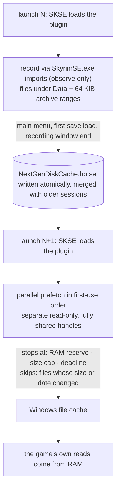

<div align="center">


[](https://github.com/SenjuWoo/NextGen-Disk-Cache/actions/workflows/build-release.yml)
[](https://github.com/SenjuWoo/NextGen-Disk-Cache/releases/latest)
[](#requirements)
[](#requirements)
[](LICENSE.txt)

**[Install](#install)** · **[Profiles](#installer-profiles)** · **[How it works](#how-it-works)** · **[Measure it](#measure-it)** · **[Troubleshooting](#troubleshooting)** · **[Build](#build)** · **[Honest status](#honest-status)** · **[Changelog](CHANGELOG.txt)** · **[Nexus](https://www.nexusmods.com/skyrimspecialedition/mods/185563)**

</div>

Skyrim loads its plugins, archives and the assets around your save with one small read at a time. On a cold start (after a reboot) every one of those reads waits on the disk; in one real 2.2.1 session, 3,022 plugin files and 509 archives were read in the 80 seconds before the main menu. **NextGen Disk Cache** is a configurable SKSE64 derivative of Disk Cache Enabler (Archost / enpinion, ISC). Since 2.3.0 it learns exactly which files, and which parts of each archive, your game reads from start-up until shortly after your first save load. At the next launch it reads that data back into the Windows file cache **in parallel**, the moment SKSE loads it, so the game's own requests come from RAM.

Version 2.3.1: learned load cache, load timing in the log, Safe by default.

## What you get

- **A load cache that learns your load order.** Each session records the files and the 64 KiB archive ranges Skyrim really reads; files you stop using drop out on their own after four launches.
- **Parallel prefetch at the next launch.** 4 parallel reads on NVMe, 2 on SATA or unknown drives, skipped on hard disks, before the game reads its plugins.
- **It never pushes the game into the page file.** Prefetch stops at a RAM reserve, at a size cap and at a deadline, and skips any file a mod update changed.
- **Read-only observation.** The game's `CreateFile` / `ReadFile` / `ReadFileEx` calls are watched through `SkyrimSE.exe`'s import table and never changed. Saves, cosaves, logs, writes and anything outside `Data` are never recorded or read.
- **Timing lines in the log** for the data load and every save load, so you can compare a cold boot with Safe against Minimal on your own machine.
- **Three installer profiles**: Safe (recommended), Minimal (the everything-off control) and Experimental.
- **No game offsets, no Address Library.** Windows APIs plus the SKSE messaging interface.


## Install

Install with Vortex or Mod Organizer 2 from [Releases](https://github.com/SenjuWoo/NextGen-Disk-Cache/releases) or [Nexus](https://www.nexusmods.com/skyrimspecialedition/mods/185563).

1. Choose **Safe** for normal play.
2. Choose **Minimal** for troubleshooting or a load-time comparison.
3. Choose **Experimental** only when you intend to benchmark it.

The installer places `NextGenDiskCache.dll` and the selected `NextGenDiskCache.ini` in `Data\SKSE\Plugins`. Upgrade by reinstalling the full FOMOD; a 2.2.x INI keeps its old warmer setting and gains the load cache with default settings.

Log and profile (Steam): `Documents\My Games\Skyrim Special Edition\SKSE\NextGenDiskCache.log` / `.hotset`  
Log and profile (GOG): `Documents\My Games\Skyrim Special Edition GOG\SKSE\`

Delete `NextGenDiskCache.hotset` to make the plugin relearn from scratch (it also relearns by itself as your load order changes). `bLogToPluginDirectory=1` puts both files beside the DLL instead.

When reporting an issue, include the complete log, profile choice, Skyrim and SKSE versions, storage type, and whether it happens without this plugin. Uninstall by removing the mod; saves are untouched. The log and `NextGenDiskCache.hotset` stay in the SKSE log folder until you delete them.

### Requirements

- 64-bit Windows
- Skyrim Special Edition or Anniversary Edition with SKSE64

DLL metadata lists **1.5.97**, **1.6.640**, **GOG 1.6.659** and **1.6.1170**, with signature-based version independence. The implementation uses Windows APIs and the SKSE messaging interface, without game-code offsets or Address Library. A full in-game runtime compatibility matrix remains open.

Do not install together with original Disk Cache Enabler or another copy of `NextGenDiskCache.dll`. It complements Faster Loadin' 'n' Savin' / S.L.A.C.K. (cosave I/O), SSE Engine Fixes and Faster Cell Lookup; it never touches the files those mods write.

## Installer profiles

| Profile | Load cache | Legacy warmer | Hooks |
| --- | --- | --- | --- |
| **Safe** (recommended) | Record + prefetch, automatic size | Off | `SkyrimSE.exe` imports only |
| **Minimal** | Off | Off | Same as Safe (control) |
| **Experimental** | Record + prefetch, 6144 MB cap, 180 s recorded | 2048 MB, strided | Process-wide Detours, random-access hint, EcoQoS opt-out, hardware profile |

The legacy warmer (Safe in 2.2.x) reads the start of every archive the game opened, after the data load. A real session showed it spreading its budget to about 2 MB per archive, the header the game had already read, and only after the save load. It stays available in Experimental and via `bEnableWarmCache=1`.

All settings live in `[HotSet]` and `[WarmCache]` of `NextGenDiskCache.ini`; each key is commented in the shipped files. The load-cache keys:

| Key (`[HotSet]`) | Default (Safe) | Does |
| --- | --- | --- |
| `iHotSetBudgetMB` | `0` = 1/8 of RAM, 512-4096 MB | Most data one prefetch reads |
| `iHotSetThreads` | `0` = NVMe 4, SATA/unknown 2, HDD skipped | Parallel reads (`1` forces it on a hard disk) |
| `iHotSetRecordSecs` | `90` | How long gameplay is recorded after the first save load |
| `iHotSetMaxSecs` | `120` | Prefetch deadline, from plugin load |
| `iHotSetMaxAge` | `4` | Launches a file may go unread before it leaves the profile |
| `iWarmCacheReserveMB` (`[WarmCache]`) | `0` = automatic, 1-8 GB by RAM size | Free RAM that prefetch always leaves alone |

## How it works



**Recording (every session, Safe and Experimental).** The plugin watches `SkyrimSE.exe`'s own `CreateFile`, `ReadFile` and `ReadFileEx` calls through the executable's import table. It never changes them. It notes:

- files under the game's `Data` folder opened for reading only, with read sharing;
- for `.bsa` / `.ba2` archives, the 64 KiB ranges that were actually read.

Recording stops 90 seconds after the first save load (or new game). The result is merged with earlier sessions: files you have not touched for four launches drop out. It is written atomically to `NextGenDiskCache.hotset` beside the log at three points: when the main menu appears, after the first save load, and when recording stops. Quitting at the main menu, a crash or a short test launch therefore keeps what was recorded up to then (before 2.3.1 such a session kept nothing).

**Prefetch (next launch).** Before the game reads its plugins, the plugin reads the recorded data with separate read-only, fully shared handles, in first-use order:

- 4 parallel reads on NVMe, 2 on SATA or unknown drives; skipped on hard disks, where parallel reads would fight the game's own seeks;
- at most 1/8 of your RAM (512-4096 MB) by default; always stops at the RAM reserve (1-8 GB by RAM size, or `iWarmCacheReserveMB`) and after 120 seconds;
- any file whose size or date changed since it was recorded (a mod update) is skipped, never guessed at.

**Never recorded or read:** saves, cosaves, save backups, logs, temporary files, anything opened for writing, deleting or creating, files opened without read sharing, and anything outside `Data`. The profile is validated line by line when loaded; a path that could leave `Data` is rejected.

The original archive flag policy is still present but narrow: on 1.6.1170 the engine never sets `FILE_FLAG_NO_BUFFERING`, so it changes nothing there (`patched=0`).

### DirectStorage

Removed in 2.3.0. DirectStorage reads are unbuffered and land in the caller's own buffers, not in the Windows file cache Skyrim reads from, and the engine never issues DirectStorage requests. It therefore cannot make Skyrim load faster. The parallel prefetch above gives the queue-depth benefit DirectStorage is known for while filling the cache the game actually uses. Old `[DirectStorage]` INI keys are ignored.

## Measure it

Every log has timing lines:

```text
HotSet: prefetched 2410 MB of 2410 MB planned (24120 files, stale=3, failures=0) in 1890 ms (1275 MB/s, 4 threads, cap 4056 MB); reason=complete
Timing: game data loaded 81.3 s after the plugin loaded (main menu ready)
HotSet: checkpoint saved at the main menu: 23950 files (23180 read so far, 412233 archive reads), 2300 MB to prefetch next launch
Timing: save data loaded in 14.2 s (SKSE PreLoadGame to PostLoadGame; ...)
HotSet: saved profile: 24310 files (24010 read this session, 520114 archive reads observed), 2440 MB to prefetch next launch
```

(Example shape, not a measurement.) The gain is largest on a **cold boot**: restart Windows, launch, load the same save. Do that once with Safe and once with Minimal. The first Safe launch only records, so compare from the second launch on. A warm relaunch (no reboot) may show little difference because Windows may still hold the files.

## Troubleshooting

| Log says | Meaning |
| --- | --- |
| `HotSet: no profile for this Data folder yet` | First launch, the profile was deleted, or the game moved. This session records; the next launch prefetches. |
| No `HotSet: checkpoint saved at the main menu` line | The game closed before the main menu, so nothing was kept. Reach the main menu once. |
| `prefetch skipped` with `hard disk detected` | Parallel reads would fight the game's own seeks on an HDD. `iHotSetThreads=1` forces it. |
| `reason=RAM reserve reached` | Free RAM fell to the reserve; prefetch stopped early instead of pushing the game into the page file. |
| `reason=deadline` | `iHotSetMaxSecs` passed before the plan finished; the rest is read by the game as usual. |
| `stale=N` | N files changed since they were recorded (mod updates). They are skipped and relearned. |
| `IAT hook was not installed` | The executable does not import `CreateFileA`/`CreateFileW` by name; nothing is recorded. Report your Skyrim version. |

## Build

Windows x64 with Visual Studio 2019, 2022 or 2026 (C++ build tools) and CMake 3.21+. Every dependency is in `deps/`, so the build downloads nothing.

```powershell
.\build.ps1            # Release x64; no downloads
.\package-release.ps1  # FOMOD zip + SHA-256
ctest --test-dir build -C Release --output-on-failure
```

`VERSION.txt` is the only place the version is written: CMake passes it to the DLL's SKSE metadata and version resource, and the packager and CI read it too. `tools/validate_rc.py` fails when the FOMOD or INI headers disagree with it.

CI builds the exact release SHA and runs the policy checks plus an isolated Windows host against the actual DLL before packaging. The host test plays two sessions: it records real reads (sequential, seeked, positional and `ReadFileEx`), then checks that the next launch prefetched exactly those ranges, skipped a changed file, preserved the caller's last error and file position, and never recorded saves, writes, exclusive opens or files outside `Data`. Two more host modes check that quitting at the main menu still leaves a profile and that prefetch stops at the RAM reserve.

```text
dumpbin /exports NextGenDiskCache.dll   →  only SKSEPlugin_Load/Query/Version
dumpbin /imports NextGenDiskCache.dll   →  SETUPAPI, KERNEL32, SHELL32 only
```

### Project map

```text
src/main.cpp         SKSE entry, file hooks, flag policy, legacy warmer, timing
src/HotSet.*         learned load cache: recorder, profile, parallel prefetch
src/IatHook.*        executable-only import-table hooks
src/version.rc.in    DLL version resource, generated from VERSION.txt
profiles/            Safe / Minimal / Experimental INI
fomod/               installer
deps/                Detours + SKSE headers (compile)
tools/               validation gate
tests/               policy and profile checks + isolated actual-DLL Windows host
```

## Honest status

Verified in this tree:

- Version **2.3.1**; Safe / Minimal / Experimental as documented
- Actual-DLL host checks for the load cache (record, prefetch, stale skip, exclusions, handle reuse, last error and file position, quit at the main menu, RAM reserve) and for every 2.2.x warmer behaviour
- 2.3.0 saved the profile only once the recording window closed, so a session that ended earlier kept nothing; an installed 2.3.0 with only short sessions had no profile at all. 2.3.1 also saves at the main menu and after the first save load
- 2.2.1 in-game evidence (Skyrim 1.6.1170 / SKSE 2.2.8): 903,412,094 bytes warmed across 509 archives, zero failures; that same log is why Safe moved to the load cache

Not yet measured:

- In-game load-time gain from the load cache. The timing lines exist so you can measure it on your own setup.
- A complete Skyrim runtime compatibility matrix

AI tools assisted development, auditing and documentation. That does not replace verification; behaviour is limited to the published source, shipped INIs and testing record.

## Contributing

Issues and pull requests are welcome; see [CONTRIBUTING.md](CONTRIBUTING.md). `ctest` and `tools/validate_rc.py` must pass, and the CI `build` check must be green on the pull request.

## Credits

- **Archost** — original Disk Cache Enabler and ISC-licensed source
- **enpinion** — original Nexus upload
- **Microsoft** — Detours
- **SKSE Team** — SKSE64 plugin interface and notices

## License

[ISC](LICENSE.txt) — original Disk Cache Enabler terms retained. See also `LICENSE.Archost-DiskCacheEnabler.txt`, `LICENSE.detours.txt` and `LICENSE.SKSE64.txt`. Full release history in [CHANGELOG.txt](CHANGELOG.txt).
